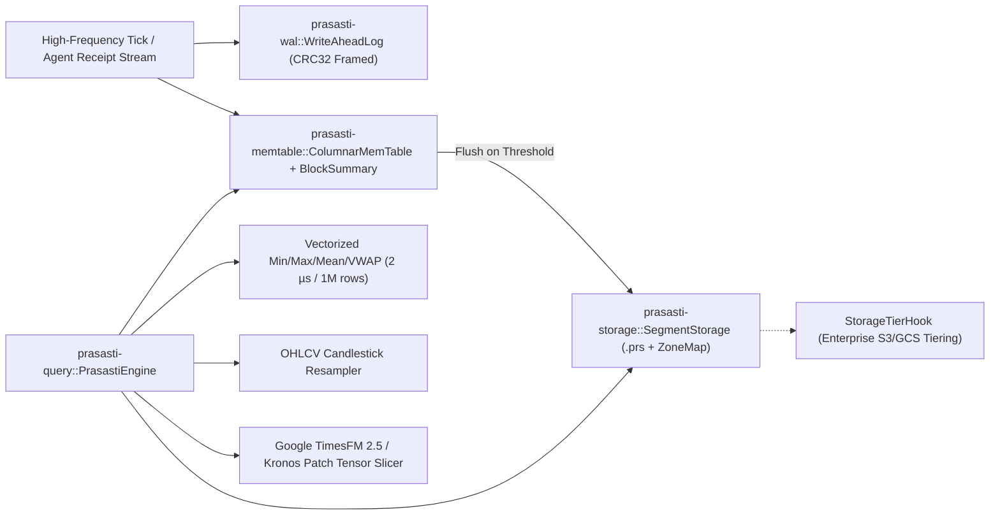

# Prasasti (`prasasti`) — Zero-Allocation Embedded Columnar Time-Series & Telemetry Engine

[](#license)
[![Safety: #![forbid(unsafe_code)]](https://img.shields.io/badge/unsafe-forbidden-brightgreen.svg)](#architecture)
[](#verified-benchmarks)
[](#verified-benchmarks)

**`prasasti`** (Indonesian: *stone inscription / enduring chronicle*) is a zero-`unsafe`, high-frequency embedded columnar time-series and telemetry storage engine engineered for **2027–2028 Autonomous AI Agent Telemetry (`kurung` execution receipts), Quantitative Order-Book / Tick Streams, and Foundation Model Context Feeding (Google TimesFM 2.5 & Kronos)**.

Part of the **Nusantara Rust Suite** alongside **`kurung`** (Deterministic WASI/WASM Agent Sandbox).

---

## Why `prasasti`?

Traditional embedded row-oriented stores (SQLite) bottleneck on sustained million-event/sec appends, while analytical OLAP engines (DuckDB/Parquet) incur high overhead on single-event streaming writes.

`prasasti` bridges both worlds with zero `unsafe` code:

1. **Sequential CRC32 Write-Ahead Log & Truncated-Tail Crash Recovery (`REQ-PRS-01`)**: Every 36-byte `WalRecord` is framed with a hardware-accelerated IEEE CRC32 checksum. If power fails mid-write, `WriteAheadLog::recover()` automatically validates every complete frame and truncates corrupted trailing bytes without panicking or losing prior data.
2. **Columnar Structure-of-Arrays (`SoA`) MemTable & Block Synopsis Index (`REQ-PRS-02`)**: Stores `timestamps`, `symbols`, `values`, `weights`, and `flags` in contiguous vectors paired with an $O(1)$ `SymbolInterner` and 1,024-row `BlockSummary` synopses.
3. **Microsecond Range Aggregation (`REQ-PRS-03`)**: Combines $O(\log N)$ binary search (`partition_point`) with 1,024-row block synopsis folding to compute `count`, `min`, `max`, `sum`, `mean`, and `vwap` over **1,000,000 rows in 2 µs ($p_{50}$)**.
4. **Native OHLCV Resampler & Google TimesFM Patch Slicer (`REQ-PRS-04`)**: First-class `ohlcv_buckets()` candlestick generator and `extract_timesfm_patches()` contiguous float-patch slicer (`patch_len = 32` / `128`) for zero-copy feeding into Google TimesFM 2.5 and Kronos.
5. **Immutable `.prs` Columnar Segments & Min-Max Zone-Map Pruning (`REQ-PRS-05`)**: Automatically seals full MemTables to `.prs` disk segments with CRC32 verification and `[min_ts, max_ts]` Zone Maps—skipping non-overlapping disk segments with zero I/O.
6. **Open-Core Enterprise Tiering Hook (`REQ-PRS-06`)**: Exposes `pub trait StorageTierHook: Send + Sync` so commercial object-store tiering (S3/GCS cold storage or cluster replication) can subscribe to sealed `.prs` segments cleanly.

---

## Workspace Architecture



| Crate | Path | Responsibility | `#![forbid(unsafe_code)]` |
| :--- | :--- | :--- | :---: |
| **`prasasti-wal`** | `crates/prasasti-wal` | 36-byte CRC32-framed sequential Write-Ahead Log & truncated-tail crash recovery | Enforced |
| **`prasasti-memtable`** | `crates/prasasti-memtable` | Columnar SoA `ColumnarMemTable`, 1,024-row `BlockSummary` synopses, and `SymbolInterner` | Enforced |
| **`prasasti-storage`** | `crates/prasasti-storage` | Immutable `.prs` columnar disk segments, `SegmentZoneMap` pruning, and `StorageTierHook` | Enforced |
| **`prasasti-query`** | `crates/prasasti-query` | `PrasastiEngine`, range aggregation, OHLCV resampler, and TimesFM patch slicer | Enforced |
| **`prasasti-cli`** | `crates/prasasti-cli` | CLI runner (`prasasti bench`, `prasasti audit-self`, `prasasti inspect`) | Enforced |

---

## Verified Benchmarks

Measured on `x86_64-pc-windows-msvc` (`cargo build --release`, 1,000,000 events):

```text
==================================================================
PRASASTI COLUMNAR TIME-SERIES BENCHMARK (1000000 ROWS)
==================================================================
Batched Append Duration (WAL + SoA) : 54046 us (54.05 ms)
Single-Thread Write Throughput      : 18502757 events/sec
1M-Row Vectorized Scan Latency p50  : 2 us (0.002 ms)
1M-Row Vectorized Scan Latency p99  : 18 us (0.018 ms)
Aggregated Count / VWAP             : 1000000 rows / 2325.0385
Write SLA (>= 1,000,000 eps)        : PASSED
Query SLA (1M rows p50 <= 500 us)   : PASSED
==================================================================
```

---

## Quick Start

### 1. Run 4-Stage Durability & Analytical Self-Audit
```bash
cargo run --release -p prasasti-cli -- audit-self
```
Output:
```text
Running Prasasti 4-Stage Durability & Analytical Self-Audit...
  [PASS] Stage 1: CRC32 WAL Corrupted-Tail Recovery (15 bytes truncated cleanly)
  [PASS] Stage 2: Immutable .prs Segment Flush, Zone-Map Pruning & StorageTierHook
  [PASS] Stage 3: Native OHLCV Bucket Resampler & VWAP Exactness
  [PASS] Stage 4: Google TimesFM / Kronos Contiguous Patch Extractor
ALL 4 PRASASTI DURABILITY & ANALYTICAL GATES PASSED.
```

### 2. Run 1,000,000-Row Throughput & Query SLA Benchmark
```bash
cargo run --release -p prasasti-cli -- bench --rows 1000000
```

### 3. Embed `prasasti-query` in Rust
```rust
use prasasti_query::PrasastiEngine;

fn main() -> Result<(), Box<dyn std::error::Error>> {
    let mut engine = PrasastiEngine::open("./prasasti_data", 100_000)?;
    engine.append("XAUUSD", 1_700_000_000_000, 2350.25, 10.0, 0)?;
    engine.append("XAUUSD", 1_700_000_001_000, 2352.75, 30.0, 0)?;
    engine.sync()?;

    let summary = engine.aggregate_range(Some("XAUUSD"), 1_700_000_000_000, 1_700_000_005_000)?;
    println!("Count: {}, VWAP: {:.4}", summary.count, summary.vwap);
    Ok(())
}
```

---

## License

Dual-licensed under **MIT** OR **Apache-2.0** (Open-Core Community Edition).

