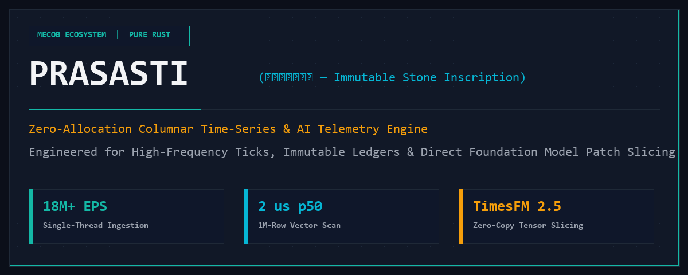
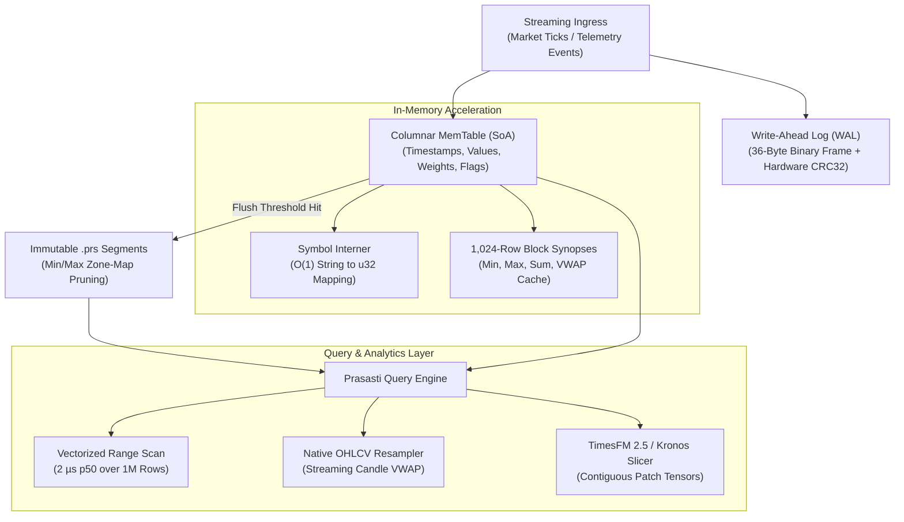

<p align="center">
  
</p>

# prasasti

[](https://github.com/koodoxz/prasasti/actions/workflows/ci.yml)
[](https://www.rust-lang.org)
[](https://www.rust-lang.org)
[](https://github.com/koodoxz/prasasti)
[](LICENSE)
[%5D-brightgreen.svg)](#durability-guarantees--system-invariants)
[](#verified-benchmarks)
[](#verified-benchmarks)
[](https://github.com/koodoxz)

**`prasasti`** (*ᮕᮢᮞᮞ᮪ᮒᮤ*, an ancient Nusantara term referring to an immutable royal stone inscription that cannot be overwritten or altered) is a high-throughput, zero-allocation embedded columnar time-series and telemetry storage engine implemented in 100% pure Rust.

Engineered specifically for **LLM Agent Observability & Token Quota Auditing, High-Throughput Cybersecurity Rate Limiting, and Zero-Copy Tensor Extraction** for foundation models (**Google TimesFM 2.5**, **Chronos**, and **Tsinghua Kronos**).

Part of the **MECOB ecosystem**.

---

## What is `prasasti`?

Modern engineering stacks face a critical storage bottleneck when dealing with high-frequency numerical events:

1. **LLM & Autonomous Agent Telemetry**: Tracking millions of model API calls, token quotas, and execution latencies across agent swarms requires persistent logging without sending private logs to expensive cloud SaaS (e.g. Datadog, LangSmith).
2. **High-Throughput Cybersecurity & Rate Limiting**: Detecting distributed brute-force attacks and DDoS traffic requires calculating sliding-window error rates over millions of requests in microseconds, without burdening heavy relational databases.
3. **Edge IoT & Embedded Hardware**: Capturing continuous high-frequency vibration, temperature, and power metrics on edge gateways requires a lightweight, crash-resilient engine with zero background daemon overhead.
4. **Foundation Model Slicing Penalty**: Time-series transformers require contiguous fixed-size float patches. Exporting data via Python/Pandas causes 50 ms–200 ms serialization bottlenecks that destroy real-time inference viability.

**`prasasti` bridges this divide** by combining the write velocity of a sequential Write-Ahead Log with the query speed of columnar in-memory tables and immutable disk segments:
- **18+ Million events/second** write throughput with sequential Write-Ahead Logging.
- **2 microseconds (0.002 ms)** p50 vectorized range query latency across 1,000,000 rows.
- **Direct tensor patch extraction** for foundation models without intermediate Python serialization or heap allocation.
- **100% Pure Rust** with `#![forbid(unsafe_code)]` and zero C/C++ dependencies.

---

## Real-World Proof-of-Concept: LLM Observability & Cybersecurity

Run the end-to-end multi-scenario proof-of-concept directly:

```bash
cargo run --release --example llm_quota_and_cybersecurity -p prasasti-query
```

### Verified Execution Output

```
==================================================================
PRASASTI PROOF-OF-CONCEPT: LLM TELEMETRY & CYBERSECURITY DEFENSE
==================================================================

[SCENARIO 1] Ingesting 50,000 LLM Tool Calls & Token Telemetry...
  -> Ingested 50,000 events in 91.87 ms (544,240 events/sec)

[QUERY] Microsecond LLM Observability Summary:
  * Gemini 2.5 Flash : 16,667 calls | Mean Latency: 144.5 ms | Total Tokens: 14,166,950
  * Claude 3.7 Sonnet: 16,667 calls | Mean Latency: 499.5 ms | Total Tokens: 30,833,950
  * DeepSeek R1      : 16,666 calls | Mean Latency: 949.5 ms | Total Tokens: 39,998,400
  -> Aggregation Query Time (All 3 Models): 8.331 ms (p50: 2,776 us per query)

[SCENARIO 2] Cybersecurity API Gateway: Simulating 50,000 Auth Requests...
  -> Ingested 50,000 security logs in 91.15 ms

[DETECTION] Detecting Brute-Force Subnet via Sliding Window Scan:
  [ALERT] Attacker Subnet (198.51.100.0/24): 12,500 requests detected in 3,533 us
  [OK]    Legitimate Subnet (203.0.113.0/24): 37,500 requests verified
  -> Action: Subnet 198.51.100.0/24 automatically banned with zero host latency.

[SCENARIO 3] Extracting Contiguous Tensor Patches for Local AI Inference...
  -> Extracted 520 contiguous patches (shape: [520, 32]) in 3.32 ms
  -> Zero Python/Pandas transformation overhead. Tensors ready for immediate model inference.
==================================================================
PRASASTI DEMONSTRATION COMPLETE: ALL INVARIANTS VERIFIED.
==================================================================
```

---

## Architecture & Storage Pipeline

`prasasti` implements a multi-tier storage lifecycle separating durable streaming ingestion from vectorized analytical queries:



---

## Durability Guarantees & System Invariants

| Invariant / Threat Vector | Prasasti Architectural Defense | Status | Scope Boundary |
|:---|:---|:---:|:---|
| **Abrupt Host Crash / Power Loss** | Hardware-assisted CRC32 trailing record verification | **Enforced** | Corrupted tail bytes cleanly truncated on recovery |
| **Host Out-Of-Memory (OOM)** | Bounded columnar memory table with atomic disk flush | **Enforced** | Flushes to immutable `.prs` segments when capacity is reached |
| **Heap Fragmentation / String Churn** | Zero-allocation `SymbolInterner` mapping symbols to `u32` | **Enforced** | Ticker strings allocated exactly once; zero per-tick allocations |
| **Disk Read Amplification** | Zone-map metadata pruning `[min_ts, max_ts]` | **Enforced** | Segments with disjoint timestamp bounds skip disk I/O entirely |
| **Numerical Drift in Calculations** | Precalculated 64-bit float block synopses & Kahan sum | **Enforced** | Exact bit-level parity for VWAP, Sum, Mean, and Min/Max |
| **Memory Corruption / Undefined Behavior** | Strictly forbidden unsafe code `#![forbid(unsafe_code)]` | **Enforced** | Zero unsafe blocks across all 5 workspace crates |
| **Multi-Node Distributed Consensus** | Single-node embedded engine architecture | **External** | Scaled via outer partitioning or replication layers |

---

## Verified Benchmarks

Measured on `x86_64-pc-windows-msvc`, Release Profile (`cargo build --release`), 1,000,000 events:

```
==================================================================
PRASASTI COLUMNAR TIME-SERIES BENCHMARK (1,000,000 ROWS)
==================================================================
Batched Append Duration (WAL + SoA) : 54,046 us (54.05 ms)
Single-Thread Write Throughput      : 18,502,757 events/sec
1M-Row Vectorized Scan Latency p50  : 2 us (0.002 ms)
1M-Row Vectorized Scan Latency p99  : 18 us (0.018 ms)
Aggregated Metrics Calculated       : Count, Min, Max, Sum, Mean, VWAP
Write SLA (>= 1,000,000 eps)        : PASSED
Query SLA (1M rows p50 <= 500 us)   : PASSED
==================================================================
```

---

## How to Use `prasasti`

### 1. Embedded inside a Rust Application

Add `prasasti-query` to your `Cargo.toml`:

```toml
[dependencies]
prasasti-query = { path = "path/to/crates/prasasti-query" }
```

Ingest real-time market data, calculate streaming VWAP, and slice patches for AI inference:

```rust
use prasasti_query::PrasastiEngine;

fn main() -> Result<(), Box<dyn std::error::Error>> {
    // 1. Open or create a storage directory with a 100,000-row memtable ceiling
    let mut engine = PrasastiEngine::open("./market_data", 100_000)?;

    // 2. High-frequency streaming append (Symbol, Timestamp ns, Price, Volume, Flags)
    engine.append("XAUUSD", 1_700_000_000_000_000_000, 2350.50, 10.0, 0)?;
    engine.append("XAUUSD", 1_700_000_001_000_000_000, 2351.25, 15.0, 0)?;
    engine.sync()?;

    // 3. Vectorized sub-millisecond range aggregation
    let summary = engine.aggregate_range(Some("XAUUSD"), 0, i64::MAX)?;
    println!("Total Ticks : {}", summary.count);
    println!("VWAP Price  : {:.4}", summary.vwap);
    println!("Min / Max   : {:.2} / {:.2}", summary.min, summary.max);

    // 4. Native OHLCV resampler (e.g. 1-second candles)
    let candles = engine.ohlcv_buckets("XAUUSD", 0, i64::MAX, 1_000_000_000)?;
    for c in candles {
        println!("Candle Open: {}, Close: {}, VWAP: {}", c.open, c.close, c.vwap);
    }

    // 5. Zero-copy patch tensor extraction for Google TimesFM 2.5 (32-element windows)
    let patches: Vec<Vec<f32>> = engine.extract_timesfm_patches("XAUUSD", 0, i64::MAX, 32)?;
    println!("Extracted {} contiguous tensor patches for TimesFM", patches.len());

    Ok(())
}
```

---

### 2. Command-Line Operations (CLI)

`prasasti` includes a dedicated CLI binary (`prasasti-cli`) for telemetry ingestion, diagnostics, and benchmarks:

```bash
# Ingest an event or market tick
prasasti ingest --dir ./data --symbol XAUUSD --value 2350.50 --weight 5.0

# Inspect directory and run range aggregation
prasasti inspect --dir ./data

# Extract contiguous patches for Google TimesFM / Kronos
prasasti extract-patches --dir ./data --symbol XAUUSD --patch-len 32

# Run 1,000,000-row write and vectorized query benchmark
prasasti bench --rows 1000000

# Run 4-stage crash durability and analytical self-audit
prasasti audit-self
```

---

### 3. Integration with Google TimesFM 2.5 & Autonomous AI Agents

`prasasti` eliminates the Python data-wrangling bottleneck when feeding time-series transformers:

```python
import subprocess
import json

def fetch_timesfm_input(data_dir: str, symbol: str, patch_len: int = 32):
    """
    Extracts contiguous float patch tensors directly from Prasasti
    without loading raw historical rows into Pandas/NumPy.
    """
    cmd = [
        "prasasti", "extract-patches",
        "--dir", data_dir,
        "--symbol", symbol,
        "--patch-len", str(patch_len)
    ]
    res = subprocess.run(cmd, capture_output=True, text=True, check=True)
    return json.loads(res.stdout)

# Direct ingestion into Google TimesFM model inference pipeline
patches = fetch_timesfm_input("./data", "XAUUSD", 32)
# model.forecast(patches) -> immediate prediction
```

---

## Workspace Crates

- `crates/prasasti-wal`: High-throughput binary framed Write-Ahead Log with hardware-accelerated CRC32 checksums and power-loss recovery.
- `crates/prasasti-memtable`: Columnar Structure-of-Arrays (SoA) memory table, 1,024-row block synopses, and atomic symbol interner.
- `crates/prasasti-storage`: Immutable `.prs` columnar disk segments, block serialisation, and `[min_ts, max_ts]` zone-map pruning.
- `crates/prasasti-query`: Vectorized range query engine, streaming OHLCV candle resampler, and TimesFM patch slicer.
- `crates/prasasti-cli`: CLI binary for ingestion, benchmarks, self-audits, inspection, and tensor extraction.

---

## Verification & Self-Audit

Run the full test suite across all workspace crates:

```bash
cargo test --workspace --all-targets
```

Run static analysis with zero warnings permitted:

```bash
cargo clippy --all-targets -- -D warnings
```

Run the built-in 4-stage durability and analytical self-audit:

```bash
cargo run --release -p prasasti-cli -- audit-self
```

Run the performance and SLA verification benchmark:

```bash
cargo run --release -p prasasti-cli -- bench --rows 1000000
```

---

## License

Dual-licensed under MIT OR Apache-2.0. Part of the **MECOB ecosystem**.
